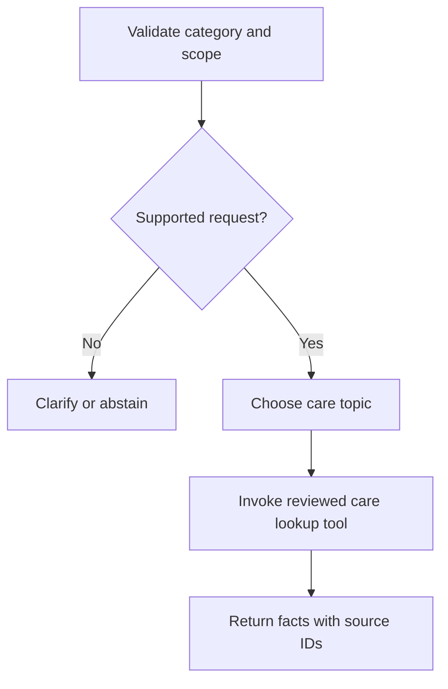

# Source-backed care workflow

The application now offers a bounded LangGraph workflow for reviewed flower-care
references. It is not a persistent or autonomous gardening agent. The image model
and care service are separate: users can correct the predicted category or look up
care without loading classifier weights.

## Flow

`POST /care/chat` accepts `flower` (optional supported category) and `question`
(at most 400 characters). An empty question requests the available overview.
Each response includes status, mode, reference plant, context note, curated facts,
source IDs/URLs and limitations. Unknown flowers fail request validation; a missing
flower prompts clarification. Uncovered topics return no invented facts/citations.

## Default: guided source lookup

No key, LLM download, embedding model or external request is needed. The graph uses
explicit topic rules, invokes the typed `lookup_flower_care` LangChain tool and
returns the reviewed evidence. The UI labels this **Guided source lookup**.
Follow-ups carry the selected flower in each request; there is no saved chat history.
This is structured retrieval from five curated profiles, not vector RAG or
free-form LLM generation. The rules understand limited English and a few Hindi
care keywords; they are not a general natural-language understanding system.

## Optional: LLM-assisted tool routing

Install `requirements-llm.txt`, then explicitly set all three server environment
variables: `LLM_API_KEY`, `LLM_BASE_URL`, `LLM_MODEL`. See `.env.example` for names.
The file is an example only: the application does not automatically load `.env`.
An OpenAI-compatible provider/model must support tool calling and required tool
selection. Choose and check provider quota/pricing yourself; no free usage is
promised. Restart the server after setting the variables. Do not commit credentials.

When all three are configured, the model gets the selected category and question
as text (not the uploaded image). One model request may choose exactly one
`lookup_flower_care` tool call. Arguments are validated against enumerated topics
and the chosen flower; arbitrary URLs, tools or changed categories are rejected.
The model never supplies the botanical answer or citation URLs. Final facts still
come from the checked-in knowledge file. There is no open-ended tool loop.

Provider errors/timeouts or invalid arguments fall back to guided lookup with an
explicit notice. Unsupported routing abstains. The provider timeout is 15 seconds
with no retries. Missing optional integration packages also trigger guided fallback.

Tests exercise LLM routing and failure paths with a fake model. No provider key was
available, so an actual external LLM request has **not** been verified.

## Knowledge and citations

Paraphrased facts are stored in `app/knowledge/care.json`, with a review date and
source attribution. Pages were inspected before facts were added:

| Category | Reviewed reference |
|---|---|
| Daisy | [NC State Extension: Shasta daisy](https://plants.ces.ncsu.edu/plants/leucanthemum-x-superbum/) |
| Dandelion | [NC State Extension: common dandelion](https://plants.ces.ncsu.edu/plants/taraxacum-officinale/) |
| Rose | [Royal Horticultural Society: growing roses](https://www.rhs.org.uk/plants/roses/growing-guide/) |
| Sunflower | [NC State Extension: annual sunflower](https://plants.ces.ncsu.edu/plants/helianthus-annuus/) |
| Tulip | [NC State Extension: tulips](https://plants.ces.ncsu.edu/plants/tulipa/) |

The broad daisy category is not equivalent to Shasta daisy: that reference is
explicitly conditional. Other category labels also do not establish botanical
species or cultivar. UK/North Carolina advice is not a locally adapted timetable.
No fixed watering dose, medical use, disease diagnosis, live forecast, reminders
or persisted plant profile is provided. Dandelion watering is deliberately
unanswered because the curated reference does not cover a schedule.

## Verification

- Python suite: source-to-answer integrity, all profiles, ambiguity, unsupported
  questions, missing facts, flower context, concurrent request isolation, fake LLM
  tool calling, invalid arguments and provider fallback.
- Browser: prediction preselects a category, manual correction, watering-to-soil
  follow-up, clickable citations, unsupported-question abstention, care while the
  classifier is unavailable, daisy caveat and mobile layout.
- Real classifier weights were used for the browser prediction flow. Optional live
  LLM routing remains unverified; user memory and vector retrieval remain future work.
